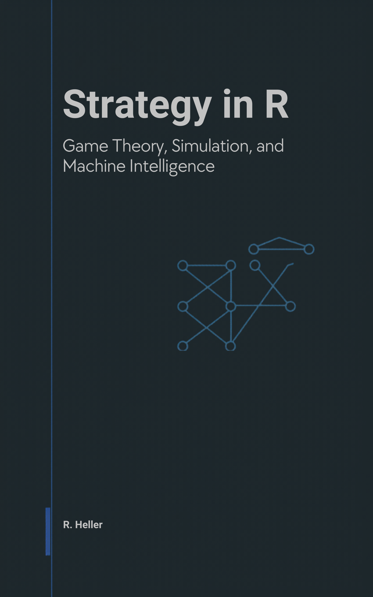

<p align="center"><a href="https://cttir.github.io/strategy-in-r/"></a></p>

# Strategy in R

*Game Theory, Simulation, and Machine Intelligence*

A free, open-source book by **Raban Heller**.

## Read it online

📖 **<https://cttir.github.io/strategy-in-r/>**

## Download

- 📄 [Whole book (PDF)](https://cttir.github.io/strategy-in-r/strategy-in-r.pdf)
- 📚 [EPUB](https://cttir.github.io/strategy-in-r/strategy-in-r.epub)
- 📑 Per-chapter PDF and EPUB: offered below each chapter’s title on the website.

## What this book covers

*Strategy in R* brings game theory and computation together in one place. It builds the foundations of strategic interaction from scratch (normal- and extensive-form games, Nash equilibrium, mixed strategies, Bayesian games, repeated games, cooperative game theory), then turns to the R toolkit and to simulation methods (Monte Carlo, agent-based models, Axelrod's tournament, replicator dynamics, network games). The second half covers reinforcement learning and modern AI through a game-theoretic lens — multi-agent RL, self-play, counterfactual regret minimisation, GANs as minimax games, and LLM agents — and closes with applications (auctions, mechanism design, matching, bargaining, empirical case studies) and a section on ethics and the future of strategic AI.

The book is for graduate students, researchers, and practitioners with working R fluency who want to apply it to strategic interaction. It is not a pure-mathematics textbook, not a general machine-learning textbook, and not a software-engineering manual.

## Table of contents

- Part I — Foundations of Game Theory
- Part II — The R Toolkit
- Part III — Simulation
- Part IV — AI and Machine Learning
- Part V — Applications
- Part VI — Ethics and the Future
- Appendices — R refresher, linear algebra, probability, exercise solutions, glossary

## How to cite

Heller, R. (2026). *Strategy in R: Game Theory, Simulation, and Machine Intelligence* (Version v0.1.0). <https://cttir.github.io/strategy-in-r/>.

```bibtex
@book{heller2026strategy,
  author    = {Heller, Raban},
  title     = {Strategy in R: Game Theory, Simulation, and Machine Intelligence},
  year      = {2026},
  publisher = {Self-published via GitHub Pages},
  url       = {https://cttir.github.io/strategy-in-r/},
  note      = {Version v0.1.0}
}
```

## Reproducibility

Built with [bookdown](https://bookdown.org/), R, and `renv`. To rebuild locally:

```bash
git clone https://github.com/CTTIR/strategy-in-r.git
cd strategy-in-r
R -e 'renv::restore()'
R -e 'bookdown::render_book("index.Rmd", output_format = "all")'
```

A handful of chapters use Python via `reticulate`; see `python/requirements.txt`.
The original lockfile remains preserved; install the optional backends only when
exercising those examples. The integration checks do not claim a fresh restoration
of every historical lockfile entry.

Before rendering, validate the functions printed in the MCTS chapter and the
configured source references:

```bash
Rscript tests/test-mcts.R
python3 scripts/check-source-refs.py
```

Serve the rendered directory with `python3 -m http.server 8000 --bind 127.0.0.1 --directory docs` and open `http://127.0.0.1:8000/`. The sidebar offers only files present in that build; PDF generation remains optional.

After rendering HTML, verify its local links with
`python3 scripts/check-html-links.py docs html-links.json`. Execution errors stop
the build. Fresh figure exports go to `_generated/figures/`, preserving the
tracked illustrations. See [the Bookdown integration record](INTEGRATION-2026-11-03.md)
for observed format checks and remaining qualification. The earlier
[Quarto maintenance record](MAINTENANCE.md) describes its historical artifacts.

## License

The prose of this book is licensed under [CC BY 4.0](https://creativecommons.org/licenses/by/4.0/); all code (scripts, chunks, examples) is licensed under the [MIT License](LICENSE-CODE.md).

## Contributing

Issues and PRs welcome. Please see [CONTRIBUTING.md](CONTRIBUTING.md).

## Validate a release build

Use Python 3 with `pypdf`, the book’s R dependencies, Pandoc and XeLaTeX.
Refresh the page notes before rendering; their dates follow source revisions,
not the day the site is built. Then validate the actual downloadable artifacts:

```sh
python3 scripts/update-page-provenance.py
Rscript -e 'bookdown::render_book("index.Rmd", output_format = "all")'
python3 scripts/finalize-book.py
python3 scripts/check-book.py
```

The final check fails on missing author/date notes, broken local links or anchors,
missing or unreadable whole-book PDF/EPUB files, and LaTeX sources left in `docs/`
(delete `docs/*.tex` first; the LaTeX file is a build intermediate). CI then builds
and checks the chapter PDF and EPUB downloads in `docs/downloads/chapters/` with
`scripts/build-downloads-ci.sh`.

## Pull-request validation

The read-only `Source checks` workflow runs on pull requests and main updates. The checks execute the teaching MCTS implementation and fresh-process setup contract, and validate source references, navigation and download fixtures. Full book rendering and publication remain separate workflow gates.
